# Dolores AR (realidad aumentada turística)

Desarrollo Móvil Integral, UTNG. RA por ubicación (GPS + brújula + cámara), pasaporte de sellos y modelo 3D.

## Cómo abrirlo y correrlo en Visual Studio Code

1. Abre la carpeta `dolores_ar` con **File > Open Folder**.
2. En la terminal, una sola vez:

   ```
   flutter create .
   flutter pub get
   ```

   Si `flutter pub get` se queja de alguna versión de paquete, ejecuta `flutter pub add camera geolocator flutter_compass model_viewer_plus`.
3. Pruebas: `flutter test` → 42 pruebas, sin GPS ni cámara ("All tests passed!").
4. App: `flutter run`. En emulador usa el **Modo demo (salón de clases)**: mueve el deslizador "Gira" y verás aparecer las etiquetas. El GPS real y la brújula solo funcionan en un celular de verdad.

## Permisos de Android (necesarios para la cámara y el GPS)

En `android/app/src/main/AndroidManifest.xml`, dentro de `<manifest>` y ANTES de `<application>`:

```xml
<uses-permission android:name="android.permission.INTERNET"/>
<uses-permission android:name="android.permission.CAMERA"/>
<uses-permission android:name="android.permission.ACCESS_FINE_LOCATION"/>
<uses-permission android:name="android.permission.ACCESS_COARSE_LOCATION"/>
<uses-feature android:name="android.hardware.camera" android:required="false"/>
```

Y en `android/app/build.gradle` (o `build.gradle.kts`), dentro de `defaultConfig`, usa `minSdk = 24` (o `minSdkVersion 24` en el .gradle normal).

## Permisos de iPhone (solo si usas Mac)

En `ios/Runner/Info.plist`:

```xml
<key>NSCameraUsageDescription</key>
<string>Usamos la cámara para mostrarte los lugares históricos a tu alrededor.</string>
<key>NSLocationWhenInUseUsageDescription</key>
<string>Usamos tu ubicación solo mientras la app está abierta, para saber qué lugares tienes cerca.</string>
```

## Notas

- Las coordenadas de `lib/dominio/catalogo.dart` son aproximadas (de práctica).
- La pantalla de inicio agrega el aviso de seguridad física del manual y se actualiza al regresar de la RA para mostrar las palomitas de los sellos.

## Estructura

```
lib/
  dominio/        geo.dart, lugar.dart, catalogo.dart, motor_ar.dart,
                  pasaporte.dart, fuentes.dart, excepciones.dart
  datos/          fuentes_reales.dart, fuentes_simuladas.dart
  presentacion/   ar_viewmodel.dart, fondo_camara.dart, pantalla_ar.dart,
                  pantalla_modelo3d.dart, pantalla_inicio.dart
  main.dart
test/
  ayudas_geo.dart, geo_test.dart, motor_ar_test.dart,
  pasaporte_test.dart, ar_viewmodel_test.dart
```

## La app funcionando en el celular

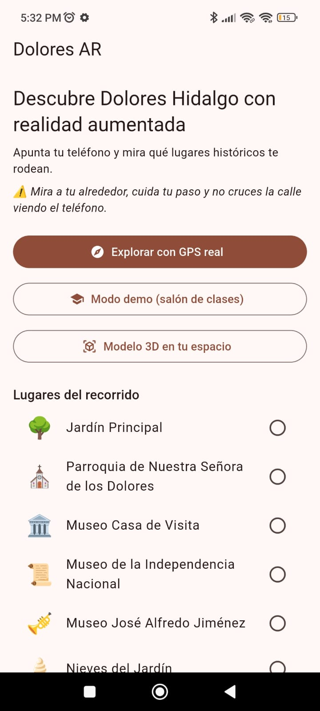

---

## Evidencias TDD (rojo → verde)

**Alumna:** Yaneli Sánchez Cárdenas · **Grupo:** GTID244

Cada ronda muestra primero la prueba en **rojo** (falla porque el código aún no existe) y después en **verde** (pasa con la implementación). En cada captura se ve la prueba que se ejecuta, el resultado en la terminal, mi nombre y mi foto de perfil.

### Ronda 1

**🔴 Rojo — la prueba falla**

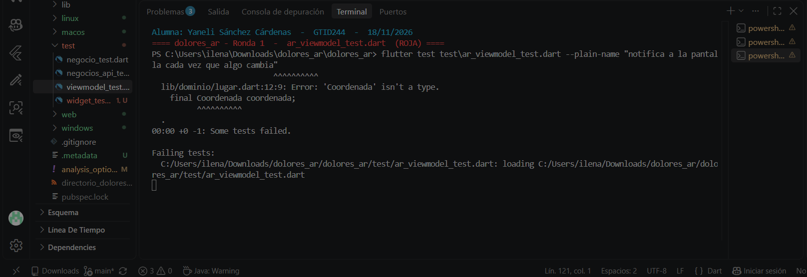

**🟢 Verde — la prueba pasa**

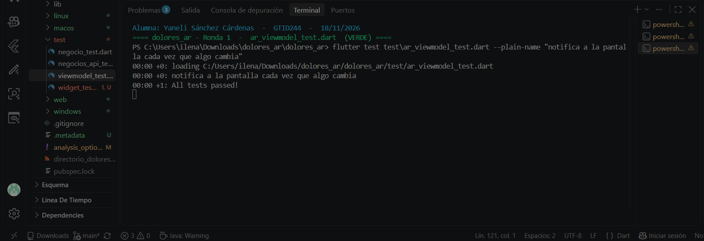

### Ronda 2

**🔴 Rojo — la prueba falla**

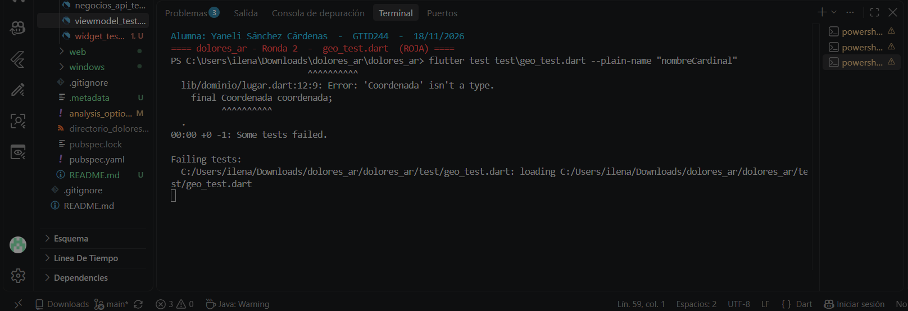

**🟢 Verde — la prueba pasa**

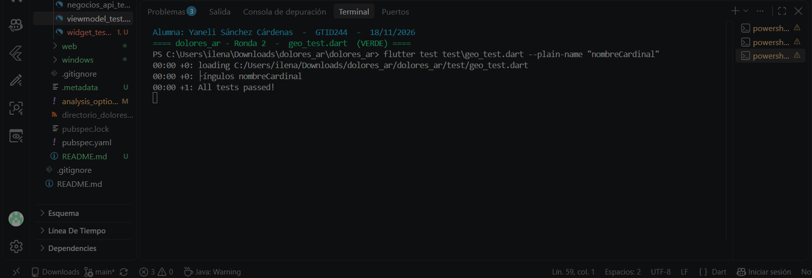

### Ronda 3

**🔴 Rojo — la prueba falla**

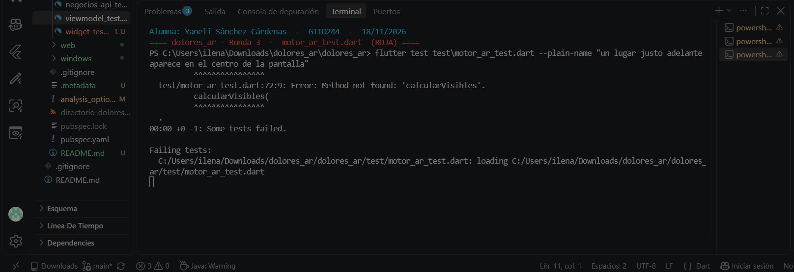

**🟢 Verde — la prueba pasa**

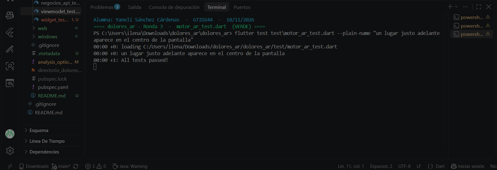

### Ronda 4

**🔴 Rojo — la prueba falla**

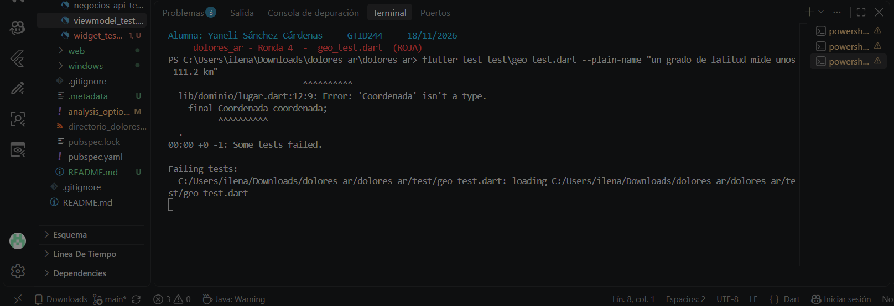

**🟢 Verde — la prueba pasa**

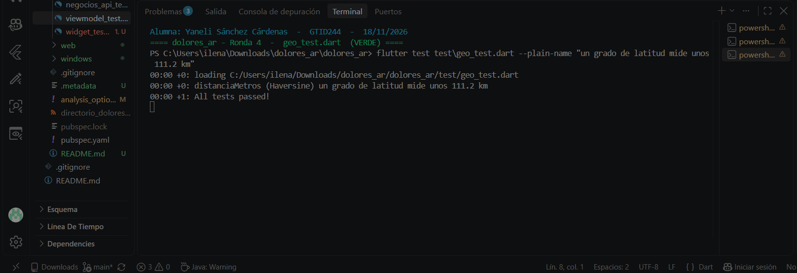

### Ronda 5

**🔴 Rojo — la prueba falla**

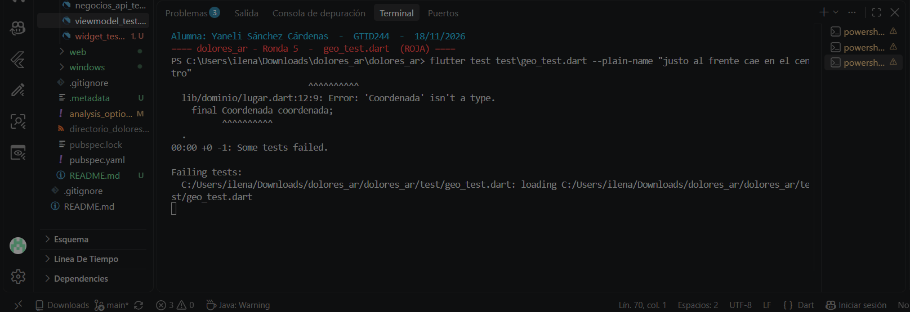

**🟢 Verde — la prueba pasa**

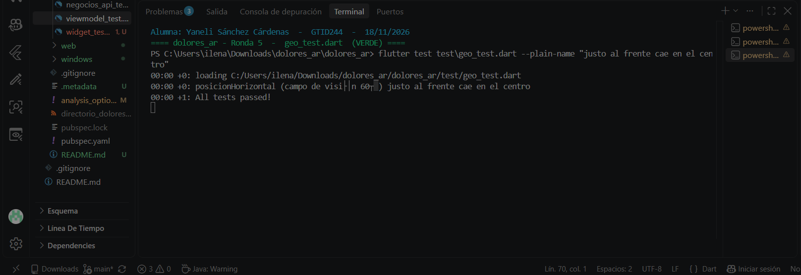

### Ronda 6

**🔴 Rojo — la prueba falla**

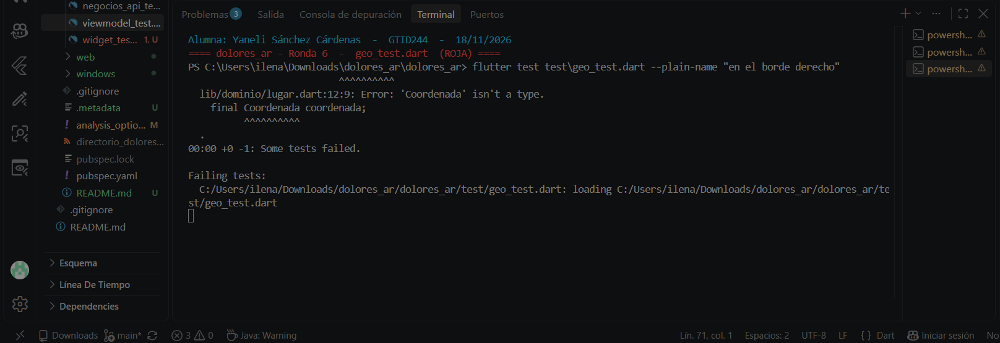

**🟢 Verde — la prueba pasa**

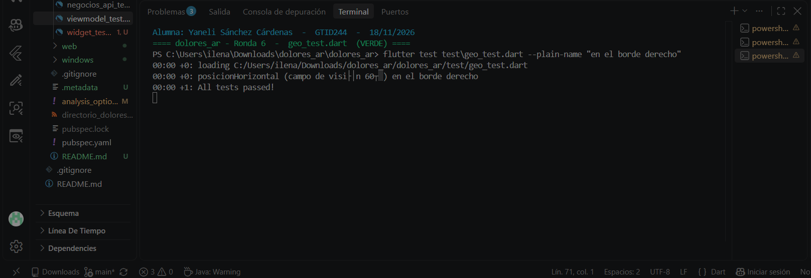
